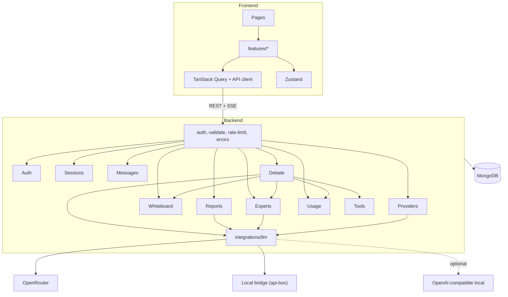
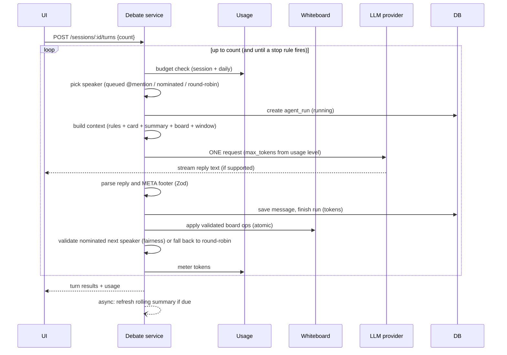

# AI Council — Architecture

## 1. Principles

1. **Modular monolith.** One backend, one frontend, strict module boundaries.
2. **One request per turn.** The expert's reply, board updates and next-speaker choice come back from a single LLM call.
3. **Pure core, impure edges.** Board ops, reply parser, selectors, context builder and budget logic are pure functions. DB and LLM calls live at the edges.
4. **LLM output is untrusted.** Everything parsed from a model is Zod-validated before it touches the DB. A bad footer never loses the reply.
5. **Providers are interchangeable.** The engine adapts to provider *capabilities*, not provider names.
6. **Everything is metered.** Each request records tokens; budgets are checked before sending.

## 2. Stack

| Layer | Choice |
|---|---|
| Language | **JavaScript (ESM)** with JSDoc typedefs for key interfaces; Zod for runtime validation. TypeScript can be adopted later without changing the architecture |
| Frontend | React, Vite, Tailwind, React Router |
| Client state | Zustand (UI only: sidebar, theme, selections) |
| Server state | TanStack Query |
| Backend | Node.js, Express, TypeScript |
| Validation | Zod |
| DB | MongoDB + Mongoose |
| Auth | JWT + argon2/bcrypt |
| Streaming | SSE (only when the provider streams) |
| Tests | Vitest, Supertest, React Testing Library, Playwright |
| Ops | Docker Compose, GitHub Actions |

## 3. System overview



## 4. Modules

| Module | Responsibility |
|---|---|
| `auth` | Register, login, JWT, `/me`, user settings |
| `providers` | Provider configs per user (encrypted keys), test connection, model lists |
| `experts` | Library, CRUD, persona card generation, "generate from description" |
| `sessions` | Session CRUD, ownership, status, expert snapshot, config snapshot, rolling summary fields |
| `messages` | Persist/list messages, `refersTo`, pagination |
| `debate` | The turn engine (see §6): selectors, context builder, reply parser, run records |
| `whiteboard` | Items, ops application, events, dedupe |
| `reports` | Generate/store/version reports |
| `usage` | Usage profiles, budget checks, metering, daily rollups |
| `tools` | Registry only in MVP (Wikipedia/search/news later) |
| `templates` | Template configs (`general` now; Boardroom/Teaching later) |
| `integrations/llm` | Provider interface + implementations, `generate`, `generateJSON`, retries |

**Rules:** modules call each other only through service exports, never each other's models. `whiteboard`, `usage` and `experts` never import `debate`; `debate` calls them.

### Folder layout

```
backend/src/
  config/            env.js (Zod), database.js
  middleware/        authenticate, validate, errorHandler, rateLimit
  modules/<name>/    routes, controller, service, model, schemas, types, __tests__
  integrations/llm/
    providers/       openrouter.js, localBridge.js, openaiCompatible.js
    prompts/         shared rules, turn builder, summary, report, expert-gen
    client.js        generate(), generateJSON(), retry, timeout
  utils/
  app.js  server.js
frontend/src/
  app/ components/ features/<name>/{components,hooks,api,types} lib/ stores/
```

## 5. LLM provider layer

```js
/**
 * @typedef {Object} ProviderCapabilities
 * @property {boolean} streaming
 * @property {boolean} reportsUsage     real token counts returned
 * @property {boolean} honorsMaxTokens
 * @property {boolean} systemRole       false = system folded into the prompt
 */
/**
 * @typedef {Object} GenerateRequest
 * @property {string} system
 * @property {string} prompt
 * @property {number} [maxTokens]
 * @property {number} [temperature]
 * @property {string} [model]
 * @property {(t: string) => void} [onToken]
 */
/**
 * @typedef {Object} LLMProvider
 * @property {ProviderCapabilities} capabilities
 * @property {(req: GenerateRequest) => Promise<{text: string, usage?: {in: number, out: number}}>} generate
 */
```

| Provider | Notes |
|---|---|
| `openrouter` | OpenAI-style chat completions; user's key and chosen models; streaming, real usage, `max_tokens` honored. Per-request key: decrypted only in memory, never logged |
| `local_bridge` | Local/self-hosted only. The URL is read from server env (`LOCAL_BRIDGE_URL`), never from user input, and the feature is off unless `ENABLE_LOCAL_BRIDGE=true`. A backend on EC2 can't reach `localhost` on your machine. Your FastAPI api-box: `POST /api/ask {provider, prompt} → {response}`. No system role, no streaming, no usage, no `max_tokens`, slow. The engine therefore: folds system into the prompt, shows the reply when complete, enforces length by prompt word cap, **estimates** tokens (chars ÷ 4) and flags them |
| `openai_compatible` (later) | Ollama / LM Studio via `baseUrl` |

`generateJSON<T>(req, schema)` wraps `generate`: extracts the JSON, validates with Zod, retries once on failure, returns `null` rather than throwing.

## 6. Turn engine (`debate`)

### 6.1 Flow



### 6.2 Reply protocol

The expert writes its message, then a footer:

```
<message text in persona>
<<<META>>>
{"board":[{"op":"add","kind":"issue","text":"..."},{"op":"resolve","ref":"i3","text":"..."}],"next":"e4"}
```

**Processing rules** (the reply must never be lost):
1. Split on `<<<META>>>`; the visible reply is everything before it, independent of the footer.
2. Save the reply regardless of footer validity.
3. Validate each board op independently; reject invalid ops without rejecting valid ones (max 2 applied per turn).
4. `next` is optional in the schema (`z.object({ board: z.array(op).default([]), next: z.string().optional() })`). Round-robin ignores it; dynamic validates it against the roster and fairness rules.
5. Missing or invalid `next` → round-robin fallback.
6. Record `footerOk`, `opsApplied`, `opsRejected` on the run.

Note: "one request per turn" covers normal debate turns only. Summaries, reports and expert generation are separate requests, recorded separately.

- Experts and board items are addressed by **short refs** (`e1…e12`, `i1…`) rather than DB ids.
- The parser streams everything before `<<<META>>>` to the UI and hides the footer.
- Footer missing or invalid → board ops dropped (logged), next speaker = round-robin, **message kept**.
- Invalid refs, duplicate items, or `resolve` of a non-existent item are dropped individually.

### 6.3 Speaker selection

| Mode | How |
|---|---|
| `round_robin` | Next member in order. No LLM involvement |
| `dynamic` | Priority: (1) user's `@mention` → (2) the previous expert's validated `next` → (3) round-robin fallback |
| `dynamic + supervisor` (later) | Extra LLM call; only when explicitly enabled |

Fairness rules applied to any nomination: not the same speaker twice in a row, no expert above ~35% of recent turns (for panels ≥ 4), and an expert who has been skipped for N turns is forced in.

### 6.4 Context builder (pure)

Order matters for provider-side prompt caching (static first):

1. **System:** shared debate rules + reply protocol (identical for every expert and session)
2. **Prompt:** topic and goal → roster (`e1 Name — role`) → *your* persona card → rolling summary → compact board → last *N* messages (N from the usage level) → "Your turn."

System/orchestrator notices are excluded. Board is capped (e.g. 8 open items + 6 latest agreements, ≤ 20 words each).

### 6.4b Turn concurrency and recovery

- One `running` run per session (partial unique index). A second request gets **409 Conflict**.
- Each turn request carries a `clientTurnId`; a unique index makes retries idempotent (same id returns the existing run).
- Save the LLM result as soon as it arrives, before secondary work, so a later DB hiccup doesn't force a paid re-request.
- A reaper marks runs stuck in `running` for more than ~5 minutes as `failed` so the session unlocks.

### 6.5 Stop rules for auto-run

Stop when any of: requested turn count done, usage level's max auto-run reached, budget hit, user pauses, a turn fails (after one retry), or 2 consecutive turns produced no board ops *and* no new `@mention`/user input (convergence).

### 6.6 Rolling summary

When `memoryMode = summary` and the message count since the last summary reaches the level's interval, the utility model produces an *incremental* update (old summary + new messages → new summary). Runs after the response is sent. `memoryMode = window` skips it entirely.

## 7. Whiteboard pipeline

1. Ops arrive from the reply footer (AI) or the founder's API call.
2. Zod discriminated union: `add | resolve | reopen | delete` (delete is user-only; agreements are created already resolved).
3. Authorize: the ref must exist in this session; AI cannot delete.
4. Dedupe by normalized text against open and recent items.
5. Apply in a **MongoDB transaction**: the item update (`version` check), the `whiteboard_events` insert and the `boardSeq` counter succeed or fail together. Local Mongo runs as a single-node replica set (docker-compose does this). Rejected ops are logged with a reason.

## 8. Usage and budgets

`usage` module owns the profile table (low/medium/high/extra) and exposes pure functions: `profileFor(level)`, `estimateTokens(text)`, `canProceed(sessionUsage, dailyUsage, profile)`. Metering increments `sessions.usage` (and `usage_daily` for reporting) atomically after each request. MVP enforces the **session** budget; the one-running-turn rule means no race inside a session. Daily caps across sessions need an atomic reserve-then-reconcile step and are deferred. Details and numbers: `TOKEN_EFFICIENCY.md`.

## 9. API (REST, `/api/v1`)

| Area | Endpoints |
|---|---|
| Auth | `POST /auth/register`, `POST /auth/login`, `GET /me`, `PATCH /me/settings` |
| Providers | `GET/PUT /providers` (key write-only), `POST /providers/test`, `GET /providers/models` |
| Experts | `GET /experts`, `POST /experts`, `POST /experts/generate`, `PATCH/DELETE /experts/:id`, `POST /experts/:id/duplicate` |
| Sessions | `POST/GET /sessions`, `GET/PATCH/DELETE /sessions/:id` |
| Messages | `GET /sessions/:id/messages?cursor=`, `POST /sessions/:id/messages` |
| Turns | `POST /sessions/:id/turns` (SSE or JSON), `POST /runs/:id/retry`, `GET /sessions/:id/runs` |
| Whiteboard | `GET /sessions/:id/whiteboard`, `POST /sessions/:id/whiteboard/ops`, `GET …/events` |
| Reports | `POST /sessions/:id/reports`, `GET /sessions/:id/reports`, `GET /reports/:id` |
| Usage | `GET /usage?range=` , `GET /sessions/:id/usage` |

Conventions: `{ data }` / `{ error: { code, message, details? } }`; Zod on every route; cursor pagination; OpenAPI generated from schemas.

## 10. Cross-cutting

- **Config:** `env.js` validates env at startup (including `KEY_ENCRYPTION_SECRET`).
- **Secrets:** provider keys encrypted with AES-256-GCM; API returns only `keyLast4`.
- **Logging:** pino with `requestId`, `sessionId`, `runId`; never log prompts containing keys.
- **Security:** helmet, CORS allow-list, rate limits (strict on auth and turns), ownership middleware.
- **Errors:** `AppError(code, status)` and one central handler.

## 11. Testing

| Level | What |
|---|---|
| Unit | reply parser, board ops, selectors + fairness, context builder, usage/budget, `generateJSON` |
| Integration | Supertest + Mongo: auth, ownership, a full turn with `FakeProvider` (scripted replies incl. broken footers), board concurrency, budget stops |
| E2E | Playwright: J1–J7 with a stubbed provider |

## 12. Deployment

Docker images for API and web; docker-compose for local (api, web, mongo, optional bridge); CI: lint → typecheck → test → build; deploy on EC2 behind a reverse proxy with HTTPS.

## 13. Decisions

| ADR | Decision | Why |
|---|---|---|
| 0 | JavaScript + JSDoc + Zod | Matches the MERN skill set; same architecture, less friction |
| 1 | Modular monolith | Right size for the project |
| 2 | MongoDB | Flexible, document-shaped data |
| 3 | One request per turn via a META footer | Cuts requests/tokens ~70–80%; essential for the slow bridge |
| 4 | Next speaker nominated by the current expert | Replaces the supervisor call and the old "look-ahead" call |
| 5 | Short refs (`e1`, `i3`) in prompts | Fewer tokens, harder to hallucinate |
| 6 | Capability flags instead of provider branches | Bridge and OpenRouter share one engine |
| 7 | Whiteboard items as separate documents | Atomic updates, per-item history |
| 8 | Separate utility model | Cheap model for summaries/reports/generation |
| 9 | Templates instead of forks | Boardroom/Teaching are configs later |