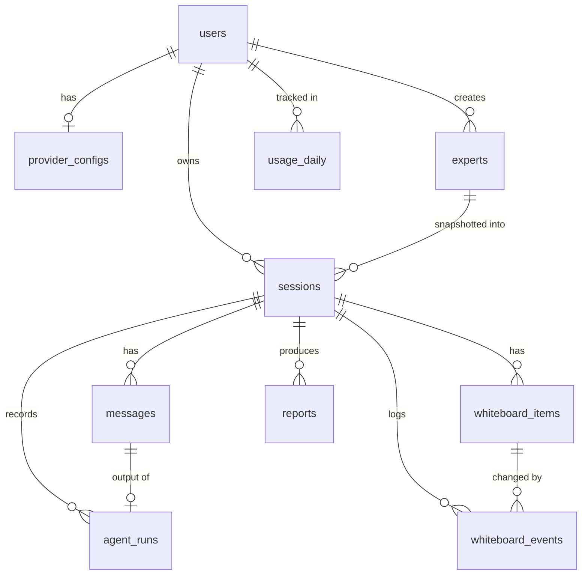

# AI Council — Database Design (MongoDB)

## 1. Conventions

- IDs are `ObjectId`; references are named `<thing>Id`.
- Every collection has `createdAt` / `updatedAt` (`timestamps: true`).
- Unbounded data (messages, runs, events, board items) gets its own collection. Small, bounded, read-together data is embedded.
- Every session-scoped query also filters by `sessionId`; ownership is checked against `sessions.ownerId` first.
- Mongoose models and Zod schemas describe the same shapes.
- **Short refs** (`e1…`, `i1…`) are stored next to ObjectIds and used in prompts.

## 2. Relationships



## 3. Collections

### 3.1 `users`
| Field | Type | Notes |
|---|---|---|
| `email` | string | lowercase, unique |
| `passwordHash` | string | never returned |
| `name` | string | |
| `settings` | object | see below |
| `dailyTokenCap` | number \| null | optional per-user cap |

`settings`: `activeProvider` (`openrouter` / `local_bridge` / `openai_compatible`), `usageLevel` (`low`/`medium`/`high`/`extra`), `orchestration` (`round_robin`/`dynamic`), `memoryMode` (`window`/`summary`), `toolsEnabled` (bool), `theme`.

**Indexes:** `{ email: 1 }` unique.

### 3.2 `provider_configs`
Kept apart from `users` so secrets are never loaded by accident.

| Field | Type | Notes |
|---|---|---|
| `userId` | ObjectId | |
| `provider` | enum | `openrouter`, `local_bridge`, `openai_compatible` |
| `encryptedKey` | string | AES-256-GCM (`iv:tag:ciphertext`); null for the bridge |
| `keyLast4` | string | the only part ever returned |
| `baseUrl` | string | only for the later OpenAI-compatible provider (validated against private ranges); **not** used for the bridge or OpenRouter |
| `upstream` | string | bridge only, e.g. `chatgpt`, `gemini` (the bridge URL itself comes from server env) |
| `debateModel`, `utilityModel` | string | OpenRouter model ids |
| `lastTestedAt`, `lastTestOk` | Date, bool | |

**Indexes:** `{ userId: 1, provider: 1 }` unique.

### 3.3 `experts`
| Field | Type | Notes |
|---|---|---|
| `ownerId` | ObjectId \| null | `null` = prebuilt |
| `key` | string | stable slug for prebuilt experts |
| `name`, `role`, `domain` | string | |
| `stance` | string | viewpoint/bias the expert argues from |
| `personality`, `speechStyle`, `backstory` | string | backstory optional |
| `card` | string | precomputed compact persona line (≤ ~60 tokens), regenerated on save |
| `tags` | string[] | for filtering |
| `avatar` | string | |
| `isActive` | boolean | soft delete |

**Indexes:** `{ key: 1 }` unique sparse; `{ ownerId: 1, isActive: 1 }`; `{ domain: 1 }`; text index on `name, role, domain, tags`.

### 3.4 `sessions`
| Field | Type | Notes |
|---|---|---|
| `ownerId` | ObjectId | |
| `members` | `[{ userId, role }]` | MVP: owner only; reserved for collaboration |
| `title`, `topic`, `context` | string | |
| `template` | string | `general` for now |
| `status` | enum | `draft`, `active`, `completed`, `abandoned` |
| `council` | array (2–12) | snapshot: `{ ref: "e1", expertId, name, role, card, domain }` |
| `config` | object | snapshot at start: `orchestration`, `usageLevel`, `memoryMode`, `toolsEnabled`, `provider`, `debateModel`, `utilityModel` |
| `summary` | string | rolling summary |
| `summaryUpToSeq` | number | last message folded into the summary |
| `messageSeq` | number | counter for `messages.seq` |
| `boardSeq` | number | counter for `i1, i2…` refs |
| `turnCount`, `lastSpeakerRef` | number, string | |
| `speakerStats` | map ref → `{ turns, lastTurn }` | fairness rules |
| `pendingMention` | string \| null | queued `@mention` |
| `usage` | object | `{ calls, tokensIn, tokensOut, estimated }` |
| `completedAt` | Date \| null | |

**Indexes:** `{ ownerId: 1, updatedAt: -1 }`; `{ ownerId: 1, status: 1 }`; text index on `title, topic`.

### 3.5 `messages`
| Field | Type | Notes |
|---|---|---|
| `sessionId` | ObjectId | |
| `seq` | number | allocated from `sessions.messageSeq` |
| `type` | enum | `user`, `expert`, `system` |
| `speaker` | object | `{ ref?, expertId?, name }` |
| `text` | string | visible text only (META footer stripped) |
| `refersTo` | `{ kind: "message" \| "item", id } \| null` | reply-to and card comments |
| `runId` | ObjectId \| null | |

`system` messages are stored for the UI but never included in LLM context.

**Indexes:** `{ sessionId: 1, seq: 1 }` unique; `{ sessionId: 1, "refersTo.id": 1 }`.

### 3.6 `whiteboard_items`
| Field | Type | Notes |
|---|---|---|
| `sessionId` | ObjectId | |
| `ref` | string | `i1`, `i2`… unique within the session |
| `kind` | enum | `issue`, `question`, `agreement` |
| `text` | string | |
| `normalizedText` | string | dedupe key |
| `status` | enum | `open`, `resolved` (agreements start `resolved`) |
| `resolution` | string | |
| `raisedBy` / `resolvedBy` | `{ type: "expert" \| "user", ref?, name }` | |
| `raisedMessageId` / `resolvedMessageId` | ObjectId \| null | |
| `resolvedAt`, `deletedAt` | Date \| null | soft delete |
| `version` | number | optimistic concurrency |

**Indexes:** `{ sessionId: 1, ref: 1 }` unique; `{ sessionId: 1, status: 1, createdAt: 1 }`; `{ sessionId: 1, normalizedText: 1 }` (partial where `deletedAt: null`).

### 3.7 `whiteboard_events`
Append-only audit log: `sessionId`, `itemId`, `op` (`add`/`resolve`/`reopen`/`delete`/`comment`), `actor`, `before`, `after`, `runId`, `rejected` + `reason` for dropped AI ops.

**Indexes:** `{ sessionId: 1, createdAt: 1 }`; `{ itemId: 1, createdAt: 1 }`.

### 3.8 `agent_runs`
One per LLM request, including summaries and reports, so cost is fully traceable.

| Field | Type | Notes |
|---|---|---|
| `sessionId`, `userId` | ObjectId | |
| `purpose` | enum | `turn`, `summary`, `report`, `expert_generate`, `test` |
| `turn` | number | for `turn` runs |
| `clientTurnId` | string | idempotency key sent by the client |
| `startedAt` | Date | used by the stale-run reaper |
| `expertRef` | string | |
| `selector` | enum | `round_robin`, `nominated`, `mention`, `fallback` |
| `status` | enum | `pending`, `running`, `completed`, `failed` |
| `provider`, `model` | string | |
| `usage` | `{ in, out, estimated: bool }` | |
| `maxTokens`, `durationMs`, `attempt` | number | |
| `footerOk` | boolean | META parsed cleanly? (quality signal for prompts) |
| `opsApplied`, `opsRejected` | number | |
| `outputMessageId` | ObjectId \| null | |
| `error` | `{ code, message } \| null` | |

**Indexes:** `{ sessionId: 1, clientTurnId: 1 }` unique (partial where `clientTurnId` exists); `{ sessionId: 1, turn: 1 }`; `{ sessionId: 1, status: 1 }`; `{ userId: 1, createdAt: -1 }`; partial unique `{ sessionId: 1 }` where `status: "running"` (one running turn per session).

### 3.9 `reports`
| Field | Type | Notes |
|---|---|---|
| `sessionId` | ObjectId | |
| `version` | number | |
| `summary` | string | |
| `positions` | `[{ ref, name, position }]` | per expert |
| `agreements`, `unresolved` | arrays | board snapshot items |
| `conclusion`, `nextSteps` | string, string[] | |
| `inputs` | `{ lastSeq, boardVersionHash }` | to detect staleness |
| `model` | string | |

**Indexes:** `{ sessionId: 1, version: -1 }`.

### 3.10 `usage_daily`
| Field | Type | Notes |
|---|---|---|
| `userId` | ObjectId | |
| `date` | string | `YYYY-MM-DD` (UTC) |
| `calls`, `tokensIn`, `tokensOut` | number | incremented with `$inc` + upsert |

**Indexes:** `{ userId: 1, date: 1 }` unique. Optional TTL for old rows.

## 4. Design decisions

| Decision | Reason |
|---|---|
| Whiteboard items as separate documents | Atomic per-item updates; no array overwrite; per-item history |
| `ref` fields (`e1`, `i3`) | Short, hallucination-resistant ids for prompts |
| `card` stored on experts and snapshotted into the session | No rebuilding persona text each turn; stable history |
| Settings in `users`, secrets in `provider_configs` | Secrets never ride along with ordinary user reads |
| `agent_runs` for every request, not only turns | One place to see where tokens go |
| `usage_daily` rollup | O(1) daily-cap check |
| `messages.seq` | Deterministic order and cursor pagination |
| `footerOk` / `opsRejected` on runs | Tells you when a prompt change hurts the META protocol |

## 5. Concurrency

- **Board ops:** run in a **transaction** (item update with `version` check + event insert + `boardSeq` increment). Requires a replica set; local docker-compose runs Mongo as a single-node replica set. One retry on version miss, then conflict.
- **Counters** (`messageSeq`, `boardSeq`): allocated with `findOneAndUpdate` + `$inc` on `sessions`.
- **Turns:** one `running` run per session (partial unique index) → 409 on a second request; `clientTurnId` makes retries idempotent; a reaper fails runs stuck in `running` > ~5 min.
- **Usage:** `$inc` on `sessions.usage` and `usage_daily`; the session budget is checked before each request (safe because only one turn runs per session). Daily caps will need atomic reserve-then-reconcile.

## 6. Retention and privacy

- Deleting a session purges its messages, items, events, runs and reports.
- Keys: encrypted at rest, decrypted only in memory per request, never logged or returned.
- Optional TTL on `agent_runs` (e.g. 90 days) once debugging data is no longer needed.

## 7. Migration from the old schema

| Old | New |
|---|---|
| Embedded `problems[]` / `openQuestions[]` | `whiteboard_items` (`issue` / `question`); `agreement` is new |
| String message ids | `messages._id` + `seq` |
| `agent` model (`description`, `personalityTraits`, `backstoryLore`, `speechStyle`) | `experts` with `stance`, `personality`, `speechStyle`, `backstory` + generated `card` |
| Provider/keys from env only | `provider_configs` per user |
| `DiscussionReport` | `reports` (versioned, staleness check) |

Old data doesn't need to migrate; a one-off script can import demo sessions if wanted.

## 8. Sample documents

```jsonc
// sessions.council[0]
{ "ref": "e1", "expertId": "665f…01", "name": "Dr. Ada Rao", "role": "Climate economist",
  "domain": "economics",
  "card": "Dr. Ada Rao — climate economist. Pragmatic, data-first, dry. Argues cost-benefit; cites numbers; skeptical of slogans." }

// whiteboard_items
{ "sessionId": "665f…9c", "ref": "i3", "kind": "issue",
  "text": "Carbon tax hurts low-income households unless rebated",
  "status": "resolved", "resolution": "Pair with per-capita dividend",
  "raisedBy": { "type": "expert", "ref": "e2", "name": "Sam Ortiz" },
  "resolvedBy": { "type": "expert", "ref": "e1", "name": "Dr. Ada Rao" }, "version": 3 }

// agent_runs
{ "purpose": "turn", "turn": 7, "expertRef": "e3", "selector": "nominated", "status": "completed",
  "provider": "openrouter", "model": "…", "usage": { "in": 812, "out": 231, "estimated": false },
  "maxTokens": 400, "durationMs": 2100, "footerOk": true, "opsApplied": 1, "opsRejected": 0 }
```